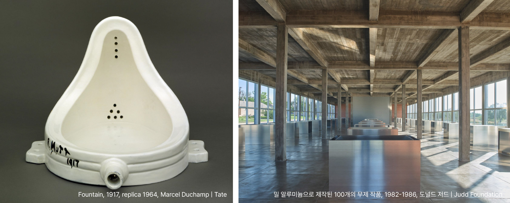
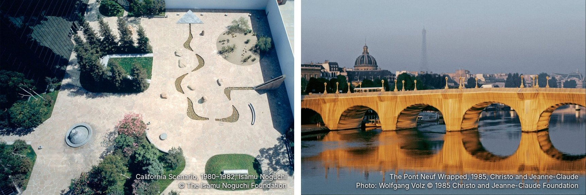
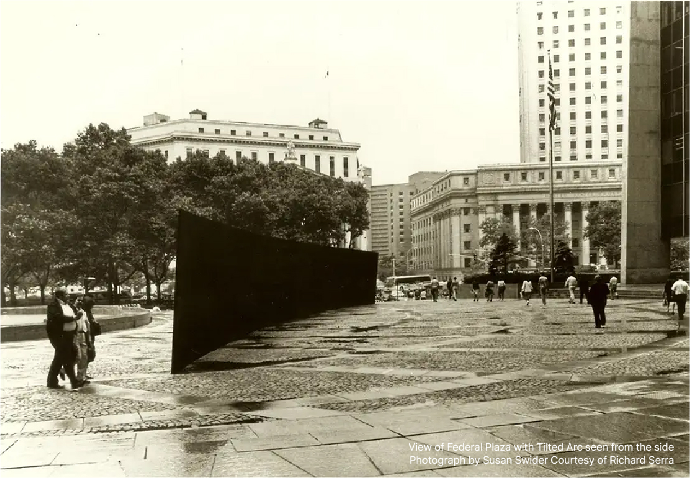
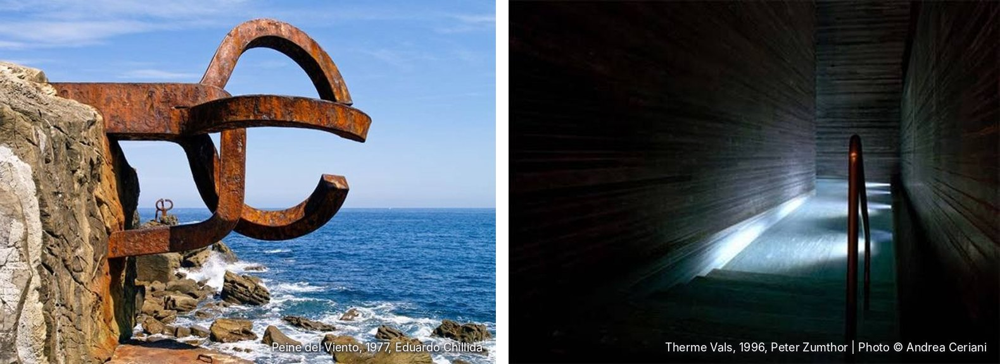
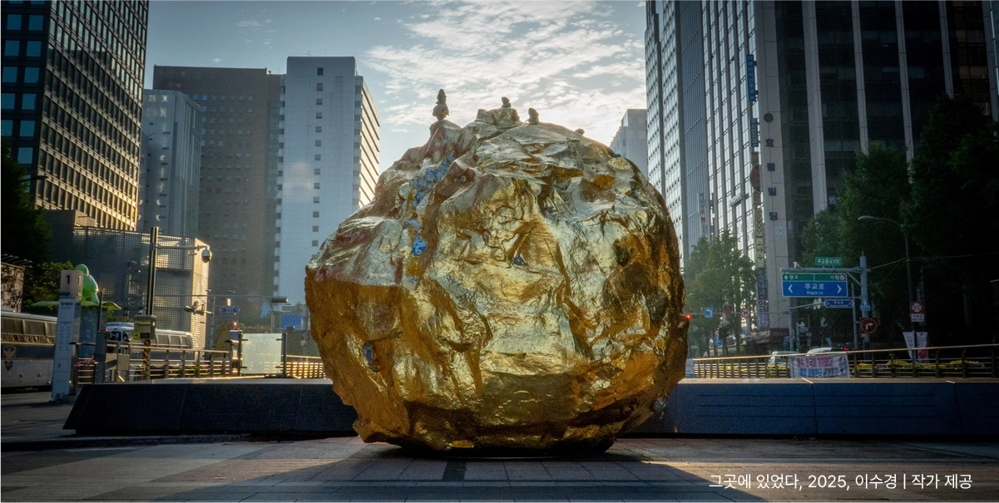

조각의 형태는 작업실의 고립된 시간 속에서 빚어지지만, 작품의 진짜 생명력은 비로소 세계의 특정한 자리를 만날 때 완성된다.

전통적인 조각은 늘 대리석이나 나무로 짠 단단한 단상, 즉 좌대(Pedestal)라는 안전한 자리를 요구했다. 조각은 그 높이 솟은 단상 위에 머물며 일상의 땅과 거리를 두었다. 그러나 근현대 미술은 그 좌대에서 과감히 내려와, 우리가 매일 걷고 숨 쉬는 현실의 바닥 위에 직접 발을 디뎠다.

조각이 좌대에서 내려온 이 시대에는 작품을 둘러싼 건축과 대지, 나아가 광장 전체가 커다란 좌대가 된다. 똑같은 조형물이라도 어떤 바닥 위에 놓이는지, 오후의 볕이 어떤 각도로 스치는지에 따라 우리에게 전혀 다른 경험을 선사한다. 하얀 미술관 안에서는 고요한 감상의 대상이 되지만, 층고 높은 상업 공간의 로비에서는 공간 전체의 중심을 잡아주는 묵직한 추가 되며, 열린 광장에서는 사람들의 일상이 교차하는 만남의 장소가 된다. 작품의 형태는 그대로이되, 공간이 작품의 새로운 의미를 빚어내는 것이다.

**자리가 바꾼 운명, 공간이 된 예술**

1917년 봄, 뉴욕의 한 전시장에 ‘R. Mutt 1917’이라 적힌 기성품 소변기가 들어왔다. 마르셀 뒤샹의 《샘》이다.¹ 이 흔한 공산품이 20세기 미술사를 뒤바꾼 이유는 단순하다. 일상의 화장실에서 떨어져 나와 ‘전시’라는 낯선 자리와 시선의 프레임 안에 놓였기 때문이다. 정작 이 작품은 전시 기간 내내 칸막이 뒤에 숨겨져 있었고, 우리가 기억하는 《샘》은 사진가 앨프레드 스티글리츠가 조명을 매만져 찍어둔 한 장의 사진이다. 사물 자체는 변한 것이 없었으나, 그것을 어디에 두고 어떻게 바라볼 것인가 하는 '맥락(Context)'이 예술을 탄생시켰다.

뒤샹이 '자리'의 힘을 보여주었다면, 이후의 거장들은 아예 물리적인 공간 전체를 작품의 일부로 끌어들였다. 도널드 저드는 미술관 벽에 작품을 잠시 걸었다 떼어내는 관습을 거부하고 텍사스의 사막 마을 마파(Marfa)로 숨어들었다.² 버려진 격납고를 사들여 오직 자신의 작품만을 위한 건축을 완성했다. 사막의 채광, 건물의 비례, 그리고 그 안에 정렬된 100개의 알루미늄 상자는 단 1밀리미터의 오차도 없이 맞물려 돌아간다.

이러한 집요함은 미술관 밖의 도시로도 뻗어 나갔다. 이사무 노구치는 바닥과 계단, 물과 돌이 흐르는 광장 전체를 하나의 거대한 조각으로 만들었고,³ 크리스토와 잔-클로드는 파리의 퐁네프 다리를 거대한 천으로 감싸 안으며 매일 무심코 지나치던 풍경을 경이로운 체험으로 뒤바꿔 놓았다.⁴ 이들에게 장소란 작품의 수동적인 배경이 아니라, 예술을 완성하는 마지막 재료였다.

**자리를 잃으면 생명력도 사라진다**

반대로 자리를 잃고 안타깝게 생명력을 잃은 거작도 있다. 1981년 리처드 세라는 뉴욕의 한 광장에 길이 37미터에 달하는 육중한 철벽 《기울어진 호》를 세웠다.⁵ 광장을 가로지르며 걷는 사람들의 동선과 시야를 완전히 새롭게 만들고자 한 정교한 기획이었다. 그러나 길을 막는다는 긴 공방 끝에 철거가 결정되었고, 다른 공원으로 옮기자는 타협안에 세라는 단호히 선을 그었다.

> *"장소특정적 작품을 옮기는 것은 곧 작품을 파괴하는 것이다."* — 리처드 세라

본래의 자리에서 강제로 뜯겨 나간 조각은 단숨에 생명력을 잃고 차가운 금속 덩어리가 되고 만다. 작품의 형태와 그것이 딛고 선 땅은 애초에 분리할 수 없는 하나의 몸이기 때문이다.

**무심한 공간을 특별한 '장소'로 만드는 힘**

때로는 압도적인 아우라를 지닌 한 점의 예술이, 텅 비어있던 공간의 공기를 완전히 뒤집으며 그곳을 대체 불가능한 ‘장소’로 창조해 내기도 한다.

철학자 마르틴 하이데거는 강줄기에 다리가 놓이는 풍경을 통해 이 마법 같은 순간을 짚어냈다.⁶ 그저 흘러가던 무심한 공간은, 구조물 하나가 닻을 내리는 순간 비로소 주변의 풍경과 흐름을 거느리며 고유한 ‘장소’로 깨어난다. 에두아르도 칠리다가 거대한 철을 구부려 대기의 허공을 끌어안고, 피터 줌터가 온천장(Therme Vals)의 육중한 돌벽 사이로 빛과 침묵의 길을 내었듯, 이들에게 ‘비어있음(Void)’은 단순한 빈 곳이 아니라 작품을 완성하는 보이지 않는 질료였다.⁷ 공간에 작품을 둔다는 것은 이처럼 거대한 덩어리가 주변의 공기를 밀어내며 빚어내는 ‘여백과 침묵의 무게’를 함께 조각하는 일이다.

현대미술가 이수경의 《그곳에 있었다(You Were There)》는 이러한 장소성의 힘을 가장 아름답게 보여준다.⁸ 상황에 따라 작가는 수 톤에 달하는 실제 바위를 공간에 들이기도 하고, 때로는 제약이 큰 장소에서 가벼운 FRP 등의 인공 소재로 거대한 부피를 만들어내기도 한다. 중요한 것은 그 위에 촘촘히 입혀진 24K 순금 금박이다.

무심하게 뒹굴 법한 돌덩이가 찬란한 껍데기를 입고 공간 한가운데에 놓이는 순간, 가장 흔한 대지의 파편은 일상의 풍경에서 벗어나 신비로운 아우라를 뿜어낸다. 미세하게 떨리는 금빛 표면이 주변의 빛과 공기의 결을 반사할 때, 멈춰 있던 공간은 비로소 고유한 장소로 깨어나며 신비로운 진동을 시작한다.

**예술이 서는 자리, 사람의 시간을 잇는 정성**

작품을 공간에 세운다는 것(Stand)은 대지를 일방적으로 누르는 것이 아니다. 그것은 작품이 지닌 무게감과 그것을 묵묵히 받아내는 땅의 기운 사이에서 관계를 팽팽하고 우아하게 조율하는 일이다. 작품 스스로 그 공간의 주체로 당당히 서게 만드는 일인 동시에, 보이지 않는 대지와 호흡하며 풍경을 받치는 또 하나의 좌대(Stand)가 되는 일이다.

미학적인 설명과 구조적인 계산을 모두 거둬내고 나면, 이 과정의 끝에서 우리가 마주하는 것은 지극히 다정하고 사려 깊은 태도다.

단순히 값비싸고 유명한 조형물을 빈자리에 채워 넣는 것이 아니다. 오직 그 자리에, 그 시간에 가장 알맞은 ‘대체 불가능한 존재’를 묵묵히 데려다 놓는 정성. 공공의 기운을 품은 작품은 한 번 자리를 잡으면 쉽게 움직일 수 없기에, 단순히 물리적인 '공간'을 채우는 것을 넘어 그곳을 스쳐 갈 수많은 사람들의 '시간'을 다독인다.

오랜 세월 비바람을 견디며 사람들의 숨결을 넉넉히 품어내야 하기에, 우리는 하나의 작품이 과연 어디에 놓여야 하는지 그 매혹적인 질문을 결코 멈출 수 없다.

**작품은 서 있는 곳에서 완성된다.**  
**WHERE ART STANDS.**

¹ Duchamp, Marcel. *Fountain*. 1917 (replica 1964). Tate Collection, London. Reference No. T07573.  
² Judd, Donald. *100 Works in Mill Aluminum*. 1982-1986. Permanent installation, The Chinati Foundation, Marfa, Texas.  
³ Noguchi, Isamu. *Public Sculptures and Environment Designs*. The Isamu Noguchi Foundation and Garden Museum Archive.  
⁴ Christo and Jeanne-Claude. *The Pont Neuf Wrapped*. 1975–1985. Paris. Artist's Official Project Archive.  
⁵ Serra, Richard. *Tilted Arc*. 1981 (dismantled 1989). Foley Federal Plaza, New York. General Services Administration (GSA) Public Buildings Service archive.  
⁶ Heidegger, Martin. "Building Dwelling Thinking". *Poetry, Language, Thought* (1971).  
⁷ Chillida, Eduardo. *Permanent Collection*. Chillida Leku Museum, Hernani, Spain. / Zumthor, Peter. *Therme Vals* (1996), Graubünden, Switzerland.  
⁸ Lee, Soo-kyung (이수경). *You Were There* (그곳에 있었다). 2025. Artist's Official Portfolio Archive.
